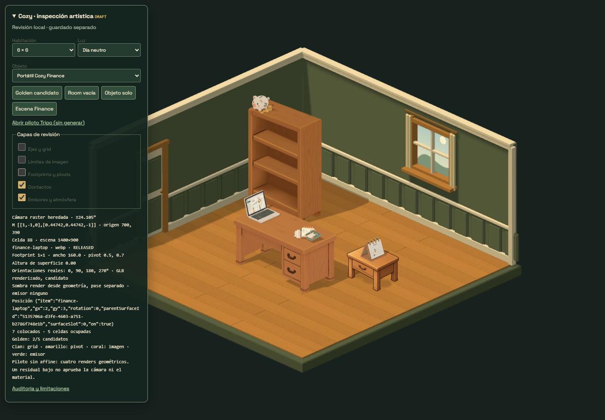
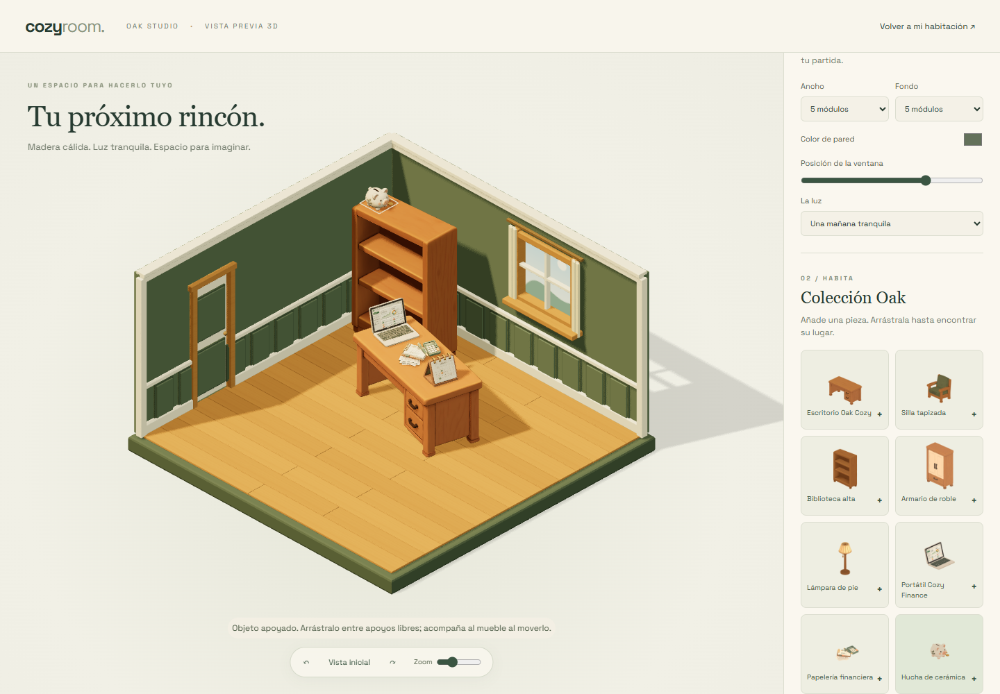

# Cozy Finance — auditoría y lote de cuatro objetos

## Estado inicial revisado el 28-10-2026

HEAD `43d18c9`, árbol de trabajo limpio antes de esta tarea. Se inspeccionaron el inventario de archivos Cozy, catálogo, manifiestos, geometría, render principal, Studio, herramientas de generación/exportación y sombreado. No hay AGENTS.md adicional dentro de Cozy.

El proyecto combina GLB reales y sprites derivados de esos GLB. `assets/released.mjs` registra cinco muebles Oak. `assets/models/oak/` contiene modelos, materiales empaquetados, cuatro vistas WebP y sombras separadas. La ruta principal consume WebP; `studio/` carga los mismos GLB con Three 0.186.1. Se reutilizará este pipeline, sin otro renderer ni nuevas pantallas.

## Contrato geométrico

- `logic/grid.mjs`: celda de 88 unidades; escritorio 2×1. `tools/oak-spec.mjs` fija su anchura real en 176 unidades.
- Cámara de exportación ortográfica: tilt 0,44742, elevación asin(tilt) = 26,578°, azimut -45°. Mundo físico `(X,Y,Z)=(x,-y,z)`; glTF Y-up se convierte a Z-up. Giros lógicos 0/90/180/270 se renderizan girando la malla, nunca deformando el sprite.
- `tools/model-review.mjs`: key fija [-70,-350,600], ambient 0,7, fill 0,3. Pivote central XY en la base real, escala uniforme. Color separado del pase de sombra.
- Escritorio: superficie a 113,739 unidades proyectadas (89,929 físicas). Biblioteca: seis apoyos medidos por raycast. Mesita auxiliar: altura heredada 92 unidades proyectadas. Silla de referencia: 119 unidades físicas de alto.
- El juego ya admite `parentSurfaceId` y `surfaceSlot`, giro/movimiento del padre y orden por profundidad. Studio actualmente solo coloca muebles en suelo: requiere extender su layout existente para apoyos y vínculos padre/hijo; no otro motor.

## Escala propuesta, a confirmar con cada GLB

Tomando un escritorio aproximado de 140 cm como referencia de proporción (suposición artística, no medida física del GLB), un portátil de 34 cm ocupa aproximadamente un cuarto de sus 176 unidades. La profundidad/altura se derivan de la malla preservando proporciones.

| ID | Anchura inicial en unidades | Uso |
|---|---:|---|
| finance-laptop | 44 | Base sobre escritorio, pantalla visible |
| finance-stationery | 40 | Conjunto compacto sobre otra zona del tablero |
| finance-piggy-bank | 34 | Cerdito crema y monedas sobre biblioteca/mesita |
| finance-desk-calendar | 28 | Soporte triangular sobre superficie pequeña |

## Referencias y preparación

Cuatro PNG adjuntos, 1536×1024, RGBA con alfa 0–254. El canal alfa no garantiza recorte limpio: hay resplandor visible alrededor de los objetos. La papelería contiene clip y post-its adicionales, excluidos por el nuevo encargo. Se preservan los originales y se prepara una versión individual limpia de cada uno con Higgsfield: alfa real sin halo/sombra ambiental; materiales más mates; sin escenarios; composición y colores conservados. Portátil con dashboard estático legible visualmente; calendario con MONTH, cuatro anillas y sin post-its; hucha crema, nunca verde; papelería limitada a calculadora, cuaderno/hojas y bolígrafo.

## Presupuesto autorizado y ejecutado

Modelos y precios consultados en Higgsfield en esta tarea:

1. Cuatro ediciones de referencia con `gpt_image_2_5`, variante flare, calidad high, resolución 1k, proporción 3:2 y fondo transparent: **1,5 créditos cada una, 6 total**.
2. Cuatro conversiones con `tripo_h3_1_image_to_3d`, 12.000 caras objetivo, textura/geometry standard, PBR false, quad false, auto_size false, original_image, orientation default: **9 créditos cada una, 36 total**.

**Tope aprobado explícitamente: 42 créditos, ocho ejecuciones en total.** Se completaron cuatro ediciones y cuatro GLB, una ejecución por objeto y etapa, sin reintentos. Coste cotizado acumulado: 42 créditos; no se ha auditado el extracto de facturación. Las autorizaciones anteriores correspondían al escritorio y al lote Oak ya terminado; no se reutilizan. Los jobs y parámetros se conservan en reference-job.json y provenance.json de cada candidato.

## Integración y criterios de aceptación

Registrar los cuatro IDs como objetos de superficie, sin funciones financieras, acciones opens, recompensas ni precios de venta nuevos. Mantener la economía y la tienda existentes; disponibilidad de revisión en el inspector/Studio, usando sus controles de colocación. No alterar rooms ni cámara. Mantener sombras de superficie separadas de sombras de suelo y pivotes derivados de bounds.

Comprobar GLB con Khronos, normales/materiales/ausencia de dependencias externas; inspección frontal, posterior, inferior y cuatro giros. Exportar PNG maestro transparente y WebP con máscaras, sin halos. Probar en una escena del sistema existente: portátil y papelería en escritorio, hucha en biblioteca/mesita, calendario en apoyo pequeño. Verificar padres/superficies, escala, rotación, profundidad, guardado y móvil. Documentar defectos de geometría o texto: no certificar un resultado solo por pasar el validador.

## Entrega revisada

| Asset | Dimensiones X × Y × Z, unidades Cozy | Escala uniforme del GLB fuente | Triángulos | GLB, bytes |
|---|---|---:|---:|---:|
| finance-laptop | 44 × 48,879 × 35,037 | 48,878509 | 10.452 | 1.021.620 |
| finance-stationery | 40 × 55,708 × 12,010 | 55,708170 | 10.944 | 1.158.504 |
| finance-piggy-bank | 34 × 33,836 × 24,127 | 34 | 11.515 | 995.536 |
| finance-desk-calendar | 28 × 34,516 × 34,327 | 34,515932 | 10.573 | 1.035.500 |

Los GLB conservan las coordenadas Y-up de Tripo, igual que Oak. El cargador existente aplica giro X de 90°, escala uniforme de la tabla, centrado XY y traslación de la base mínima a Z=0. Los límites exactos se incluyen en asset.mjs. No se deforma la geometría ni se aplica axisFix a Finance. No confundir unidades glTF fuente con unidades Cozy: al importar fuera de Cozy hay que aplicar este contrato.

Las cuatro mallas tienen normales, UV y una textura 2048² empaquetada; no requieren archivos externos. Khronos: cero errores, cero advertencias y cuatro avisos informativos BUFFER_VIEW_TARGET_MISSING por modelo. Cada objeto tiene cuatro PNG maestros RGBA 768², cuatro WebP de color, cuatro pases de sombra WebP y máscara de selección. Las cuatro entregas de color suman 204.676 bytes. La transparencia final procede del render de geometría: alfa 0–255 sin el fondo/halo de la referencia.

El formato sigue siendo mixto: WebP en el juego y GLB en Studio. La cámara de exportación conserva azimut -45°, elevación 26,578° y proyección ortográfica. Los marcos pequeños de Finance miden 140/160 unidades, pivot de imagen (0,5; 0,7), con pivote geométrico en la base. Studio conserva su cámara orbital existente.

## Integración nativa

- Los cuatro IDs pertenecen a EDITOR_ITEMS y CATALOG, fuera de ITEMS, tienda, inventario inicial y colecciones con recompensas. No tienen opens, emisores ni acciones financieras. Se impide comprar o vender estos objetos de revisión.
- Acceso: catálogo de /cozy/studio/; en /cozy/?art-debug=true, botón «Escena Finance» dentro del inspector existente. El guardado de revisión y el de Studio están separados de la partida normal.
- El juego reutiliza parentSurfaceId, surfaceSlot, cuatro orientaciones, selección por alfa y orden de profundidad existentes. Las sombras generadas se recortan al plano del mueble receptor.
- Studio amplía su layout v1 con padre y apoyo opcionales; conserva los bocetos antiguos. Mover/girar el mueble transforma a los hijos; retirar el padre retira sus hijos, y Deshacer los recupera. El arrastre de accesorios y las flechas saltan entre apoyos libres; los giros son de 15° o 90°. Se rechazan posiciones fuera del tablero, colisiones y apoyos ocupados.
- Biblioteca en Studio: seis apoyos interiores medidos por raycast en X=±44, Y=0, con límite de altura entre baldas. Se conservan los apoyos heredados del juego. No se modifica su malla.
- Mesita heredada: su altura declarada de 92 hacía flotar el calendario. Se calibró a 58 unidades proyectadas a partir del centro del tablero en el PNG existente y su escala, sin modificar el sprite ni la habitación.

## Evidencia y comprobaciones

- 32 pruebas unitarias pasan; incluyen aislamiento de economía, modelos empaquetados, apoyos, rotación del padre y rechazo de padres/apoyos inválidos.
- qa-finance.cjs: cuatro objetos sobre muebles, giro, movimiento del padre, recarga, retirada con hijos, Deshacer, escritorio y móvil 360 px, sin cambios en la partida normal, sin errores de consola ni respuestas HTTP fallidas.
- qa-studio.cjs, qa-pilot.cjs, tests/browser.cjs y tests/builder.cjs: pasan. Las suites de navegador se ejecutaron con Edge instalado; el Chromium descargado de Playwright no estaba disponible.
- Se revisaron las 16 orientaciones, materiales, vistas traseras e inferiores, y capturas dentro de los dos renderizadores. La selección del calendario conserva MONTH y cuatro anillas; la hucha es crema y tiene monedas; la papelería no incluye los post-its sueltos ni el clip.

Capturas reales:

[Vista móvil del juego](qa/finance/game-mobile.png) · [Vista móvil de Studio](qa/finance/studio-mobile.png) · [Resultado automatizado](qa/finance/results.json)

## Archivos

- assets/models/finance/{ID}/: cuatro GLB, asset.mjs con escala/pivotes/vistas, WebP, sombras, procedencia y resumen técnico.
- assets/candidates/tripo-{ID}/: referencia editada, jobs, GLB original, PNG maestros, revisión de geometría, máscaras y validación glTF.
- assets/released.mjs y art-registry.mjs: registro de los cuatro recursos.
- logic/catalog.mjs, engine.mjs y geometry-profile.mjs: catálogo de revisión, protección frente a transacciones y apoyo calibrado de la mesita.
- studio/layout.mjs y studio.mjs: apoyos, vínculos padre/hijo, controles y validación. assets/models/oak/bookshelf/asset.mjs añade solo apoyos 3D medidos.
- ui/art-debug.mjs, shadows.mjs, room.mjs y edit.mjs: escena de prueba y sombras sobre superficies.
- tools/oak-spec.mjs, model-review.mjs, encode-pilot.py y promote-oak.mjs: mismo pipeline extendido a Finance y a marcos pequeños.
- tests/finance.test.mjs, tools/qa-finance.cjs y docs/qa/finance/: pruebas y evidencia.

## Limitaciones conocidas

El acabado es el de la generación Tripo usada por Oak: más liso y con menos detalle que los PNG originales. El dashboard y los números son textura estática; el texto pequeño pierde definición y no tiene significado funcional. El calendario conserva un eco de textura verde en el interior del soporte, visible al ampliar/rotar; no es una pieza ni un post-it añadido. El cuaderno conserva pestañas de índice integradas de la referencia.

Las composiciones se entregan como una unidad por objeto; sus partes no se articulan ni se seleccionan por separado. El apoyo usa bounds y puntos medidos, no simulación física: pequeños redondeos y desniveles de las mallas generadas pueden dejar contactos milimétricos imperfectos. No se certifica geometría CAD/manifold. El juego mantiene su orden de capas por objeto; Studio ofrece oclusión geométrica real. En móvil, el texto decorativo es naturalmente diminuto; la navegación y colocación se comprobaron a 360 px, sin certificar rendimiento en teléfonos de gama baja.
